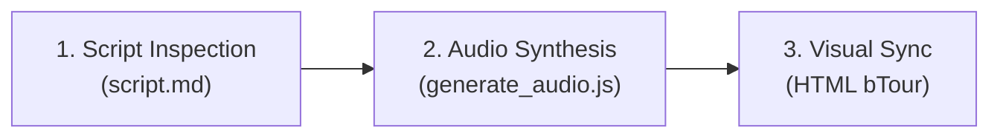

# 🎙️ Notion Playbook: ElevenLabs Audio Walkthroughs on Windows

> **Goal**: Generate studio-quality ElevenLabs voice walkthroughs on a Windows PC where the ElevenLabs API is not yet configured in the terminal, without needing administrator privileges or installing complex build tools.

---

## 📑 Table of Contents
1. [Prerequisites & Repository Sync](#1-prerequisites--repository-sync)
2. [File Map on Windows](#2-file-map-on-windows)
3. [10-Second API Key Setup on Windows](#3-10-second-api-key-setup-on-windows)
4. [Step-by-Step Generation Workflow](#4-step-by-step-generation-workflow)
5. [Ready-to-Paste Prompts for Your Windows AI Session](#5-ready-to-paste-prompts-for-your-windows-ai-session)
6. [Windows Verification & Troubleshooting](#6-windows-verification--troubleshooting)

---

## 1. Prerequisites & Repository Sync

Open **PowerShell** or **Windows Terminal** in your project folder and pull the latest changes that include the skill export:

```powershell
cd C:\path\to\Animated-Solutions
git pull
```

> 💡 **What this pulls**:
> - The new `.agents\skills\elevenlabs-audio-walkthrough\` skill folder
> - Portable `elevenlabs-audio-walkthrough.zip`
> - Zero-dependency Node.js and Python generator scripts
> - All updated visualizer files with the unified Guided Audio Tour architecture

---

## 2. File Map on Windows

Here is where all files live on your Windows machine:

```
📁 Animated-Solutions\
├── 📄 .env.local                                      <-- (Created in Step 3) Holds your API key (git-ignored)
├── 📦 elevenlabs-audio-walkthrough.zip                <-- Standalone zip archive of the skill
├── 📁 .agents\
│   └── 📁 skills\
│       ├── 📁 elevenlabs-audio-walkthrough\           <-- Workspace skill folder
│       │   ├── 📄 SKILL.md                            <-- Skill instructions for AI assistants
│       │   ├── 📁 scripts\
│       │   │   ├── 📄 generate_audio.js               <-- Zero-dependency Node 18+ generator (native fetch)
│       │   │   └── 📄 generate_audio.py               <-- Zero-dependency Python 3 generator (urllib)
│       │   └── 📁 references\
│       │       ├── 📄 prompts.md                      <-- Copy-paste prompt templates
│       │       └── 📄 windows-setup.md                <-- Windows setup reference
│       └── 📁 solution-to-3d-animation\               <-- 3D visualizer authoring skill
├── 📁 audio-walkthroughs\
│   └── 📁 <problem-slug>\                             <-- e.g., balanced-brackets, leftmost-binary-search
│       ├── 📄 script.md                               <-- Spoken text & cue timestamps table
│       ├── 📄 WALKTHROUGH-PLAYBOOK.md                 <-- Problem-specific guide
│       └── 🎵 *.mp3                                   <-- Generated voice clips
└── 📁 <visualizer-folder>\
    └── 🌐 *.html                                      <-- Single-file 3D animation HTML
```

### Making It a Global Skill (Optional)
If you want the skill available in **any** folder on Windows (not just this workspace):

```powershell
# In PowerShell:
New-Item -ItemType Directory -Force "$env:USERPROFILE\.gemini\antigravity\skills\"
Copy-Item -Recurse .agents\skills\elevenlabs-audio-walkthrough "$env:USERPROFILE\.gemini\antigravity\skills\"
```

---

## 3. 10-Second API Key Setup on Windows

You do **not** need Administrator privileges or to touch Windows system properties. Pick **one** method:

### 🌟 Option A: Local `.env.local` File (Recommended)
Run this once from your project root in PowerShell:
```powershell
Set-Content -Path .env.local -Value "ELEVENLABS_API_KEY=your_actual_api_key_here"
```
*(In CMD: `echo ELEVENLABS_API_KEY=your_actual_api_key_here > .env.local`)*

> 🔒 **Why this is best**: Both Node.js and Python generator scripts automatically find and parse `.env.local`. Git ignores it by default, preventing accidental credential leaks.

---

### Option B: Current Terminal Session Only (In-Memory)
If you prefer not writing your key to disk, set it in your current PowerShell window:
```powershell
$env:ELEVENLABS_API_KEY = "your_actual_api_key_here"
```
*(In CMD: `set ELEVENLABS_API_KEY=your_actual_api_key_here`)*

---

### Option C: Official ElevenLabs Interactive Onboard
```powershell
npx -y @elevenlabs/cli@latest onboard init
```
This prompts you securely in the terminal and generates `.env.local` automatically.

---

### Verification: Test That Windows Sees Your Key
In PowerShell, run:
```powershell
node -e "import fs from 'node:fs'; console.log(fs.existsSync('.env.local') ? '✔ .env.local found' : '❌ .env.local missing')"
```

---

## 4. Step-by-Step Generation Workflow



### Step 4.1: Script Inspection & Segment Authoring
1. Examine the visualizer's `simulate()` function and `SRC` code lines.
2. Create `audio-walkthroughs\<problem>\<preset>\script.md` containing a Markdown segment table:
   - **Clip Filename** (e.g. `01-setup-and-key-idea.mp3`)
   - **Spoken Text**: Conversational words ("three" instead of "3", "equals" instead of "=="; no markdown or stage notes).
   - **Approximate Duration**.

### Step 4.2: Synthesize Audio Files
Run the zero-dependency Node.js script (Node 18+ has native `fetch`):

```powershell
# 1. Preview characters and estimated credits without spending anything:
node .agents\skills\elevenlabs-audio-walkthrough\scripts\generate_audio.js audio-walkthroughs\<problem>\script.md --dry-run

# 2. Synthesize all clips:
node .agents\skills\elevenlabs-audio-walkthrough\scripts\generate_audio.js audio-walkthroughs\<problem>\script.md
```

> **Default Voice Parameters**:
> - **Voice**: `"Lauren"` (`"Lauren - Friendly, Comforting and Soft"`, ID: `DODLEQrClDo8wCz460ld`)
> - **Model**: `eleven_multilingual_v2`
> - **Stability**: `50%`
> - **Similarity Boost**: `75%`
> - **Style**: `0%`
> - **Speaker Boost**: `true`

### Step 4.3: Synchronize with the 1-Click Guided Audio Tour
In the target `.html` visualizer file:
- Ensure the **Hero Tour Button** (`#bTour`), **Mute Button** (`#bMute`), and **Live Status Pill** (`#tourStatus`) are present in `#controls`.
- Connect the `WALKTHROUGHS` object with relative paths (e.g., `../audio-walkthroughs/<slug>/01-setup.mp3`).
- Set exact cue timestamps `{ time: 0.0, frameIdx: 0 }` so the visualizer steps automatically as the voice speaks.

---

## 5. Ready-to-Paste Prompts for Your Windows AI Session

Copy and paste these directly into your AI assistant chat window on Windows (Antigravity, Claude Code, Cursor, Windsurf, etc.):

### Prompt 1: Windows Environment Bootstrap
```markdown
# TASK: Setup & Verify ElevenLabs Environment on Windows

You are working in the repository on my Windows PC.

I need to generate educational audio walkthroughs using ElevenLabs, but I have NOT added the ELEVENLABS_API_KEY to my Windows terminal environment variables yet.

Please perform the following bootstrap steps:
1. Check if `.env.local` or `.env` exists in the project root containing `ELEVENLABS_API_KEY`.
2. If neither exists, check if `process.env.ELEVENLABS_API_KEY` is present.
3. If no key is configured:
   - Provide me with the exact PowerShell command to create `.env.local` locally (`Set-Content -Path .env.local -Value "ELEVENLABS_API_KEY=your_key_here"`), OR
   - Run `npx -y @elevenlabs/cli@latest onboard init` to let me securely input it via terminal.
   - Do NOT ask me to paste API keys directly into this chat transcript.
4. Once configured, verify the connection by listing available voices (looking for "Lauren" or "Alice") and confirm ready status.
```

---

### Prompt 2: Author Narration Script (`script.md`)
```markdown
# TASK: Author Narration Script for [PRESET_NAME]

Target Visualizer:
`[PATH_TO_HTML]` (e.g., `12-balanced-brackets/Balanced brackets in 3D, step by step.html`)

Target Preset:
- Preset Name: "[PRESET_NAME]"
- Arguments: [INPUT_VALUES]

Output Destination:
`audio-walkthroughs/[PROBLEM_SLUG]/[PRESET_SLUG]/script.md`

Requirements:
1. Inspect the visualizer's actual `simulate()` function and `SRC` code lines. Do not guess the step sequence.
2. Formulate 4 to 6 concise spoken segments matching key educational milestones:
   - Setup & Key Idea
   - Iterations / Comparisons / Stack Operations
   - State updates (pointer moves, highlights)
   - Termination and final result
3. Format as a Markdown segment table:
   | Clip ID | Filename | Animation Cue / Frame | Code Lines | Spoken Text | Approx Duration |
4. Guidelines for Spoken Text:
   - Written out in clear, natural conversational English for ElevenLabs TTS (write "three" instead of "3", "equals" instead of "==").
   - Zero markdown formatting, stage directions, or brackets in the spoken text column.
5. Provide pronunciation notes and character counts.
```

---

### Prompt 3: Synthesize Audio Files
```markdown
# TASK: Synthesize Audio Clips for [PROBLEM_SLUG]/[PRESET_SLUG]

Input Source:
`audio-walkthroughs/[PROBLEM_SLUG]/[PRESET_SLUG]/script.md`

Output Directory:
`audio-walkthroughs/[PROBLEM_SLUG]/[PRESET_SLUG]/`

Settings:
- Voice: "Lauren" (or "Alice" if Lauren is not present)
- Model: Eleven Multilingual v2 (`eleven_multilingual_v2`)
- Stability: 50%
- Similarity Boost: 75%
- Style: 0%
- Speaker Boost: ON

Workflow:
1. Read the segment table in `script.md`.
2. Display a credit approval summary before spending credits:
   - Table of filenames and character counts
   - Total character count and estimated credits
   - Request confirmation to proceed.
3. Upon approval:
   - Run: `node .agents/skills/elevenlabs-audio-walkthrough/scripts/generate_audio.js path/to/script.md`
   - Verify every `.mp3` file is generated and non-empty.
   - Report finished file list with sizes.
```

---

### Prompt 4: All-in-One Autonomous Execution
```markdown
# TASK: End-to-End Guided Audio Tour for [PROBLEM_NAME]

Target: `[PATH_TO_HTML]`
Preset: "[PRESET_NAME]"

Please execute the complete 3-step walkthrough pipeline:
1. Environment check: Confirm `.env.local` contains `ELEVENLABS_API_KEY`. (If not, guide me to create it in PowerShell).
2. Author `audio-walkthroughs/[SLUG]/script.md` based on the visualizer's actual `simulate()` logic.
3. Show character count and estimated credits, then generate `.mp3` files into `audio-walkthroughs/[SLUG]/` using the Lauren voice.
4. Integrate the clips into the visualizer using the 1-Click Guided Audio Tour architecture (`#bTour`, `#bMute`, `#tourStatus`, cue timestamp mapping).
5. Run automated verification and confirm zero console errors.
```

---

## 6. Windows Verification & Troubleshooting

### How to Preview Visualizers with Audio on Windows
Browsers block audio if HTML files are opened directly via `file:///C:/...`. Run a local dev server:

```powershell
# Using Python (standard on Windows):
python -m http.server 8000

# Or using Node.js:
npx serve .
```
Then open `http://localhost:8000` in Chrome/Edge.

### Common Windows Issues & Fixes

| Issue | Cause | Fix |
| :--- | :--- | :--- |
| **"Audio autoplay blocked"** | Browser security restriction | Clicking `#bTour` initiates `.play()` inside the user gesture, bypassing blocks automatically. |
| **"Cannot find module"** | Missing npm packages | Use `.agents\skills\elevenlabs-audio-walkthrough\scripts\generate_audio.js` which has **zero dependencies** and uses built-in `fetch`. |
| **"Command not found: node"** | Node.js not installed | Run with Python: `python .agents\skills\elevenlabs-audio-walkthrough\scripts\generate_audio.py`. |
| **PowerShell script execution policy** | Restricted execution policy | Run scripts with: `node script.js` (does not require altering execution policy). |
| **CRLF line endings** | Windows Git line-ending conversion | The parser trims whitespace and `\r\n` automatically. |

---

> 💡 **Tip for Notion**: You can copy and paste this entire markdown document directly into a new Notion page. Notion will automatically convert headers, code blocks, callouts, and tables into native Notion blocks!
